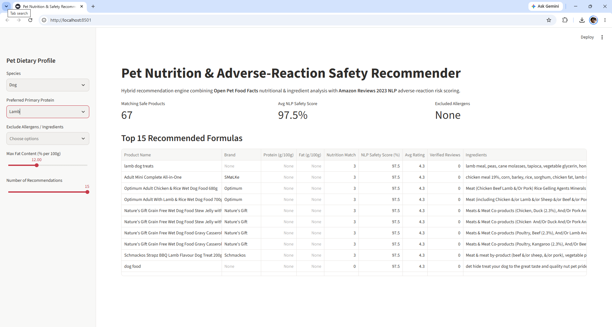
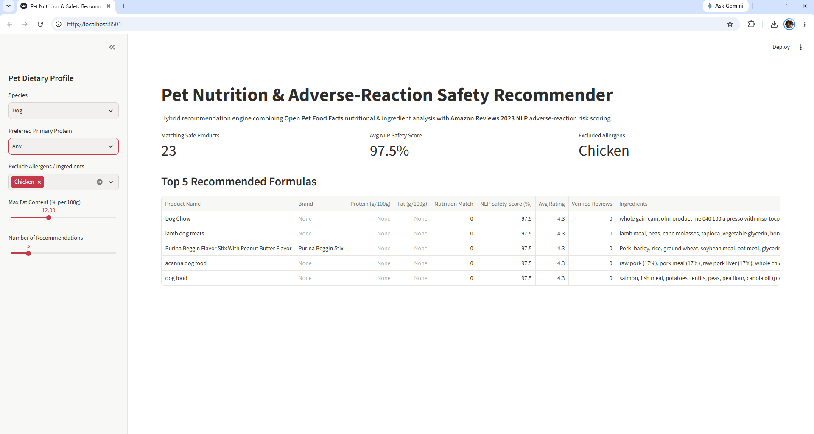
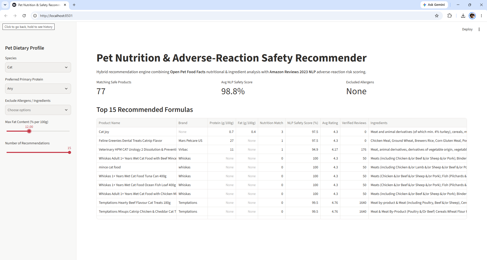
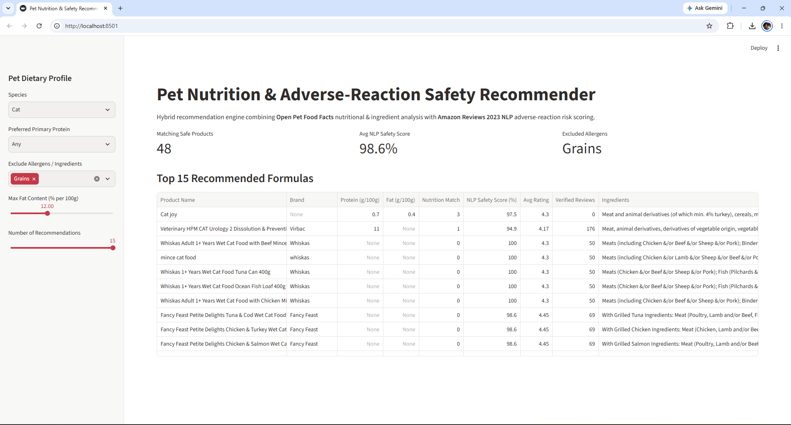

# Pet Nutrition & Adverse-Reaction Safety Recommender

**[Launch Live Interactive App](YOUR_STREAMLIT_URL)**

> Part of my **[AI & Data Science Portfolio](https://github.com/anikkamw/ai-data-science-portfolio)**

## App Preview

### Dog Dietary Filtering
**Standard Search (No Allergen Exclusions)**


**Allergen-Filtered Search (Excludes Selected Allergens)**


### Cat Dietary Filtering
**Standard Search (No Allergen Exclusions)**


**Allergen-Filtered Search (Excludes Selected Allergens)**


An end-to-end hybrid recommendation engine and interactive Streamlit application that matches pets with safe, nutritionally aligned food formulas while screening out brands with elevated customer-reported adverse reactions.

## Project Overview
Commercial pet food selection requires balancing ingredient sensitivities (such as poultry or grain allergies), macronutrient constraints, and real-world product safety. This project combines structured nutritional/ingredient data with large-scale NLP review mining into a single decision-support pipeline:

1. **Nutritional & Multilingual Allergen Filtering (Open Pet Food Facts):**
   - Ingested and cleaned **15,976 product records** from Open Pet Food Facts.
   - Engineered language detection filters and multilingual allergen synonym mapping (`chicken`, `poultry`, `poulet`, `volaille`, `huhn`) to prevent false-negative allergen leaks across international product labels.
   - Extracted primary protein indicators (`salmon`, `lamb`, `beef`, `chicken`) and macronutrient profiles (`proteins_100g`, `fat_100g`) to score dietary suitability.

2. **Adverse-Reaction NLP Classifier (Amazon Reviews 2023):**
   - Streamed **15,000 pet food/treat product metadata records** and **100,000 customer reviews** from the UCSD Amazon Reviews 2023 dataset.
   - Built a weak-supervision labeling pipeline targeting digestive upset, skin allergies, and illness reports paired with low star ratings (`~2.3%` positive class prevalence).
   - Trained a class-balanced **TF-IDF (1–2 n-grams) + Logistic Regression** classifier to score reviews and aggregate brand-level **NLP Safety Scores**.

3. **Interactive Streamlit Web Application (`app.py`):**
   - Allows users to configure species (`Dog` / `Cat`), preferred primary protein, excluded allergens, and maximum fat thresholds to dynamically re-rank formulas by both **Nutrition Match** and **NLP Safety Score**.

---

## Repository Structure
```text
pet-nutrition-safety-recommender/
├── data/
│   ├── clean_pet_nutrition.parquet        # Cleaned English pet food catalog & ingredient flags
│   └── brand_nlp_safety.parquet           # Aggregated NLP brand safety & rating metrics
├── notebooks/
│   └── 01_pipeline_and_nlp_modeling.ipynb # Data streaming, EDA, feature engineering & NLP training
├── app.py                                 # Interactive Streamlit recommendation app
├── requirements.txt
└── README.md
